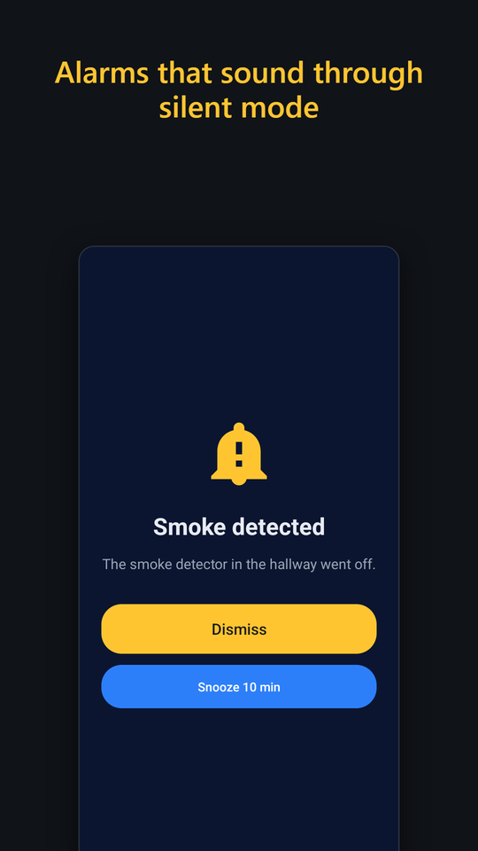
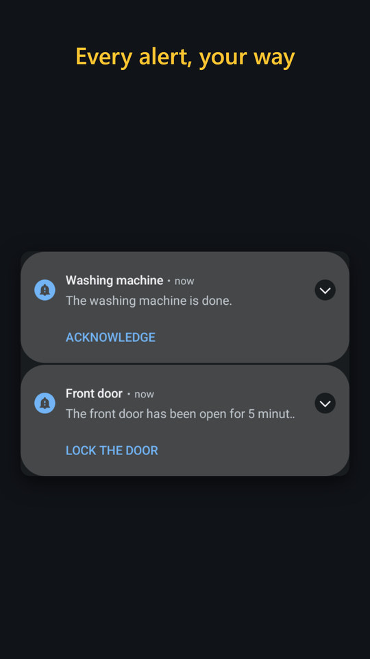
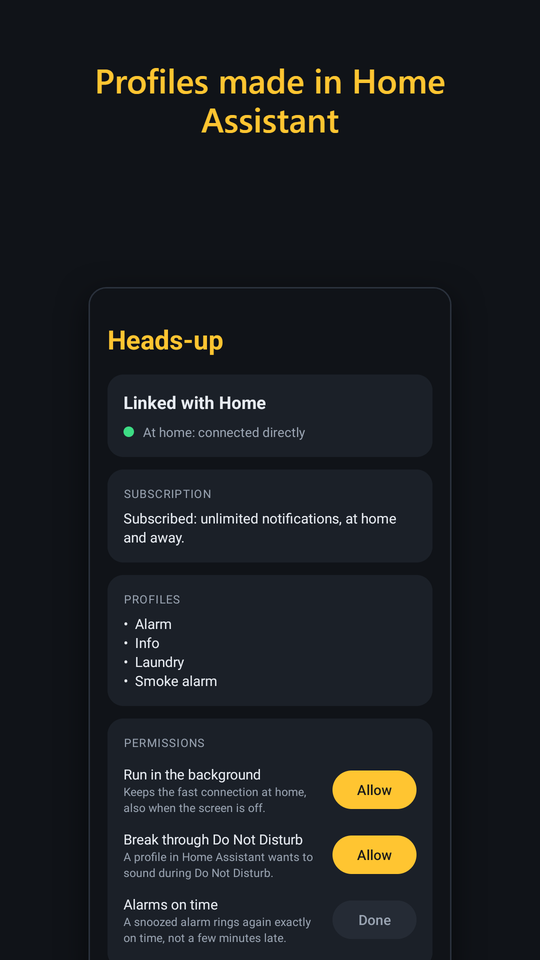
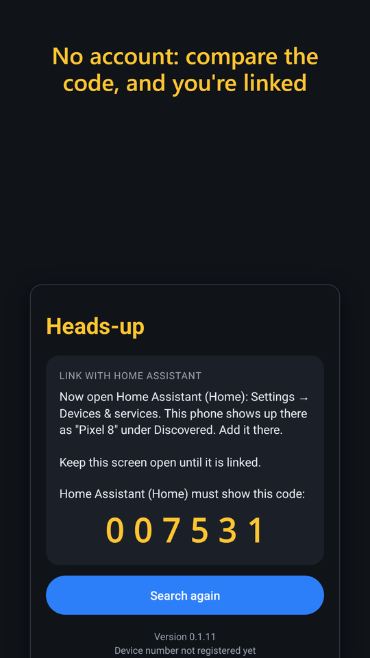

# Heads-up for Home Assistant

The Home Assistant integration for the **Heads-up** Android app: notifications
that behave the way you set them up. A smoke alarm that sounds through silent
mode and Do Not Disturb with a full-screen alarm, a quiet note when the
washing machine is done, a reminder that moves itself past your appointments.

At home the phone keeps a direct, encrypted connection to your own Home
Assistant. Away from home, notifications travel end to end encrypted through
a small relay. There is no account and no login.

<p>
  
  
  
  
</p>

## Installation

[](https://my.home-assistant.io/redirect/hacs_repository/?owner=WeekendBunnies&repository=ha-headsup&category=integration)

**HACS:** the button opens this repository in HACS (it uses [My Home Assistant](https://www.home-assistant.io/integrations/my/), which is
on by default). Or by hand: HACS > three dots > Custom repositories > add
`https://github.com/WeekendBunnies/ha-headsup` as type *Integration*, install
**Heads-up**, then restart Home Assistant.

**By hand:** copy `custom_components/headsup` into your Home Assistant
`config/custom_components/` folder and restart.

Then install the **Heads-up** app from
[Google Play](https://play.google.com/store/apps/details?id=com.weekendbunnies.headsup)
on each phone.

## Linking a phone

1. Open the app on your home Wi-Fi and pick your Home Assistant.
2. In Home Assistant, Settings > Devices & services shows the phone under
   **Discovered**. Select **Add**.
3. Check that Home Assistant shows the same six digit code as the phone, and
   confirm.

The first phone also creates the Heads-up entry; later phones join it.
Unlinking in the app removes the phone in Home Assistant too.

## Profiles

A profile decides how a phone handles a notification. Make them under
Heads-up > **Configure**:

| Setting | |
|---|---|
| Sound, vibration, importance | built in tones and patterns |
| Sound even when the phone is silent | plays through the alarm volume |
| Break through Do Not Disturb | after the user allows it in the app |
| Full-screen alarm | with Dismiss and Snooze, also on the lock screen |
| Repeat the sound until answered | |
| Buttons | Acknowledge, Snooze |
| Snooze for, Ring for at most, Snooze automatically at most | an alarm nobody answers snoozes itself, then stays as a silent "Missed" notification |

The phones learn the profiles from Home Assistant; there is nothing to set up
on the phone.

## Sending

Each phone gets a **notify** entity, and there are two actions:

```yaml
action: headsup.send
data:
  device_id: 0123456789abcdef0123456789abcdef   # leave out to send to every phone
  profile: Smoke alarm                           # leave out for the default profile
  title: Smoke detected
  message: The smoke detector in the hallway went off.
  entities:
    - sensor.hallway_temperature                 # their current state is shown
  buttons:
    - id: call
      title: Call home
  tag: smoke                                     # a newer one with the same tag replaces it
  ttl: 600                                       # don't show it when it arrives later than this
```

```yaml
action: headsup.clear
data:
  tag: smoke        # removes the notification, its alarm screen and a pending snooze
```

The automation editor also has the device actions **Send heads-up** and
**Clear heads-up**, with a list of your profiles.

## Answers from the phone

Every tap fires the event `headsup_action` with `device_id`, `phone`,
`message_id`, `tag` and `action`:

| action | |
|---|---|
| `acknowledge`, `snooze` | the buttons |
| your button's `id` | a button you sent along |
| `snooze_cleared` | the user cleared a snoozed alarm |
| `auto_snoozed` (with `count`) | nobody answered, it snoozed itself |
| `unanswered` | still nobody after the automatic snoozes |

```yaml
triggers:
  - trigger: event
    event_type: headsup_action
    event_data:
      action: call
```

## Scheduled alarms

Under **Configure > Add a scheduled alarm**, Home Assistant works out alarms
from your calendars, and every phone keeps the times, so an alarm also rings
when the phone has no connection at that moment.

* **On set days at a set time**, moved past appointments: "every Wednesday at
  12:00 to put the bin out; when there's an appointment then, an hour after it,
  and past the next one too, until there is free time".
* **For appointments in a calendar** whose title contains a text, or is exactly
  that text: "90 minutes before every shift".

Each alarm can have conditions, and rings only when all of them hold: the
appointment starts between two times ("only for morning shifts"), is on
certain days, its title contains a text or not, that day has another
appointment or not ("not on a holiday"), or an entity has a state or not.

Home Assistant looks two weeks ahead and updates the phones every 15 minutes.
Each phone has a **Next alarm** sensor.

## Entities per phone

| Entity | |
|---|---|
| Home connection | whether the phone is connected at home right now |
| Last seen at home | |
| Subscription | subscribed, household, free, or free notifications used up |
| Next alarm | the next scheduled alarm |
| notify | for `notify.send_message` |

## Free and subscription

Linking and setting up are free, and so are the first 10 notifications at
home. A subscription in the app gives unlimited notifications, at home and
away, and starts with a free trial. A household subscription covers up to 6
phones on the same Home Assistant. Home Assistant shows a repair when a phone
needs one.

## Security and privacy

Linking uses ECDH on P-256 and shows a six digit code on both screens, so you
can see that nobody sits in between. Every message is encrypted with AES-256-GCM
using the key the two made, also on your home network. The relay that carries
notifications away from home can't read them: it only sees a device number and
a hashed send key. Privacy policy: <https://weekendbunnies.com/apps/headsup/privacy/>.

## Requirements

Home Assistant 2025.3 or later, and phones with Android 8 or later. The
integration's icon shows from Home Assistant 2026.3.

## License

MIT
